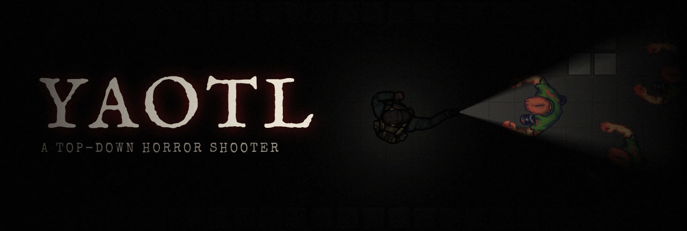

<h1 align="center"></h1>


[](https://github.com/landoicco/yaotl/actions/workflows/ci.yml)
[](LICENSE)


A top-down horror shooter made with [LÖVE](https://love2d.org/). You wake up in a dark, unknown place with only a flashlight, and the only way out is forward.

The flashlight is the only real light, and its battery runs down. With a weapon out you stand in the dark, and only the flash of each shot shows what is coming. Seeing and defending become a trade-off.

📄 See the [Game Design Document](docs/GDD.md) for the design.

## 🎮 Controls

| Action | Input |
|---|---|
| Move | `W` `A` `S` `D` |
| Run | `Shift` (hold) |
| Aim | Mouse |
| Shoot | Left click |
| Strike | Right click |
| Reload | `R` |
| Switch between the flashlight and the last weapon | `Q` |
| Take out the handgun / shotgun | `1` / `2` |

## ✨ Technical highlights

The game is carried by its systems more than by its art. Each design decision is recorded in an [Architecture Decision Record](docs/adr/README.md).

- 🔦 **Lighting with real shadows.** A lightmap darkens the scene, and every light (the flashlight, the halo around the player, muzzle flashes, lamps) adds to it through a shader with a soft falloff. Walls block light: each light's area is a visibility polygon, built from rays cast to the wall corners within its range. [ADR 0003](docs/adr/0003-lighting.md)
- 🧟 **Zombie navigation.** One breadth-first flow field from the player serves every zombie, and is recomputed only when the player moves to another cell. When nothing is in the way, a zombie walks straight at the player instead. [ADR 0004](docs/adr/0004-zombie-navigation.md)
- 🧱 **One raycast for everything.** `Map:castRay` walks the grid cell by cell (a DDA traversal), so it never skips a wall. Bullets, light and zombies all use it.
- 🎛️ **Player as a hierarchical state machine.** What the player holds is a state, and one set of weapon states serves every weapon. Melee is a substate of whatever is held, so punching keeps the flashlight lit. [ADR 0001](docs/adr/0001-player-state-machine.md), [ADR 0002](docs/adr/0002-shared-weapon-states.md), [ADR 0005](docs/adr/0005-melee-states.md)
- 🔊 **Audio tied to animation frames.** Sounds are played by name from one registry, so replacing one is a single line. Animations say which frames make sounds, so a reload clicks when the hand reaches the gun. [ADR 0006](docs/adr/0006-audio.md)
- 🧩 **Engine and game kept apart.** `src/engine/` knows nothing about Yaotl, and a module moves there only after the game has used it and it has proved to be generic.
- ⚙️ **Reproducible tooling.** A Nix flake pins every tool, and CI runs the same luacheck and StyLua as local checks. Every pull request builds the game for Windows and Linux. The sprite sheets, the placeholder sound effects and the banner above are generated by scripts in `tools/`; the sound effects and the banner come out byte for byte the same on every run.

## 🚀 Playing

### 📦 Downloads

Tagged versions are published as [releases](https://github.com/landoicco/yaotl/releases). Every pull request also builds the game for Windows and Linux; the builds are under the run's *Artifacts* in the Actions tab.

- **Windows:** extract the whole zip first, then run `yaotl.exe`; it does not run from inside the zip.
- **Linux:** make the AppImage executable (`chmod +x yaotl-linux.AppImage`) and run it. It needs FUSE 2 (`libfuse2`).

### 💻 From the source

The game targets **LÖVE 11.5**. With Nix:

```bash
nix develop
love .
```

Without Nix, install [LÖVE 11.5](https://love2d.org/), then run `love .` from the project root.

## 🛠️ Development

### 🔍 Checking the code

CI rejects code that fails [luacheck](https://github.com/lunarmodules/luacheck) or [StyLua](https://github.com/JohnnyMorganz/StyLua). Both come with the Nix dev shell, at the same versions CI uses:

```bash
luacheck .
stylua --check .  # or `stylua .` to format
```

### 📦 Building

`tools/build.sh` builds the same files as CI into `build/`. It needs `curl`, `zip`, `unzip` and `squashfs-tools`. With Nix:

```bash
nix shell nixpkgs#zip nixpkgs#unzip nixpkgs#squashfsTools --command tools/build.sh
```

### 🗺️ Editing maps

Maps are made in [Tiled](https://www.mapeditor.org/), which comes with the Nix dev shell. See [`maps/README.md`](maps/README.md) for how to edit and export them, and the layers the game expects.

### 🔊 Generating sound effects

Some sound effects are generated from short recipes (filtered noise and falling tones) in [`tools/sfx/main.lua`](tools/sfx/main.lua), as placeholders until better ones are found. They are made for this game, so they have no third-party credit. After changing a recipe, regenerate them from the project root:

```bash
nix develop -c love tools/sfx
```

### 🖼️ Generating the banner

[`tools/make-banner.sh`](tools/make-banner.sh) builds the banner and the repository's social preview (`docs/images/`) from the game's tiles and sprites, lit like the game. The social preview is uploaded by hand, under *Settings → General → Social preview*. The header of the script lists the two fonts it needs in `assets_local/fonts/`. Then, from the project root:

```bash
nix develop -c ./tools/make-banner.sh
```

## 💡 Ideas

Under consideration, not yet part of the design:

- 🧪 **Zombie variants by recoloring.** One zombie sprite, with each type getting its own color (a tint or a shader) and scale, so new types need no new art.
- 🍎 **A macOS build.** Built from LÖVE's official `love.app` like the Windows and Linux ones. It would not be signed, so macOS would ask players to allow it by hand.
- 🔋 **Pickups.** Batteries for the flashlight, health and ammo, found along the way.
- 🚪 **The ending.** Either the player escapes the dark place, or wakes up.

## 🪶 About the name

*Yaotl* (pronounced *YA-otl*) is a Nahuatl word meaning **enemy**, and by extension **combat** or **war**. Some sources also translate it as **warrior**, which fits a game about a lone survivor facing a horde. See the entry in the [Gran Diccionario Náhuatl](https://gdn.iib.unam.mx/diccionario/yaotl/18899) (UNAM).

## 🙏 Credits

The art, audio and fonts are free third-party assets, except the generated sound effects. Each one is credited here with its author, source and license.

| Asset | Author | Source | License |
|---|---|---|---|
| Survivor sprites | rileygombart | [Animated Top Down Survivor Player](https://opengameart.org/content/animated-top-down-survivor-player) | [CC-BY 3.0](https://creativecommons.org/licenses/by/3.0/) |
| Zombie sprites | rileygombart | [Animated Top Down Zombie](https://opengameart.org/content/animated-top-down-zombie) | [CC0](https://creativecommons.org/publicdomain/zero/1.0/) |
| Ambient track, converted to Ogg Vorbis | Jason Dagenet (jdagenet) | [Is Anybody Home?](https://opengameart.org/content/is-anybody-home) | [CC-BY-SA 3.0](https://creativecommons.org/licenses/by-sa/3.0/) |
| Reload sounds | Brian MacIntosh (BMacZero) | [Gun Reload Sound Effects](https://opengameart.org/content/gun-reload-sound-effects) | [CC0](https://creativecommons.org/publicdomain/zero/1.0/) |
| Banner title font: IM Fell English SC | Igino Marini | [Google Fonts](https://fonts.google.com/specimen/IM+Fell+English+SC) | [OFL 1.1](https://openfontlicense.org/) |
| Banner subtitle font: Special Elite | Astigmatic | [Google Fonts](https://fonts.google.com/specimen/Special+Elite) | [Apache 2.0](https://www.apache.org/licenses/LICENSE-2.0) |

## 📄 License

The code and the generated sound effects are released under the [MIT License](LICENSE). Third-party assets keep their own licenses, listed in [Credits](#-credits).
